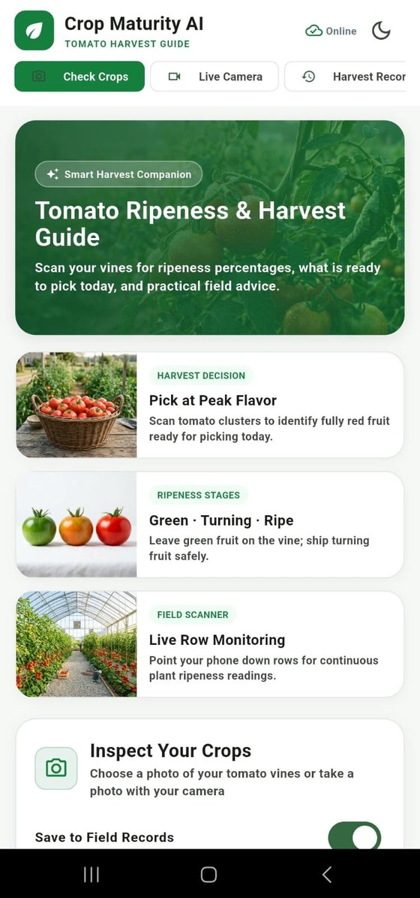
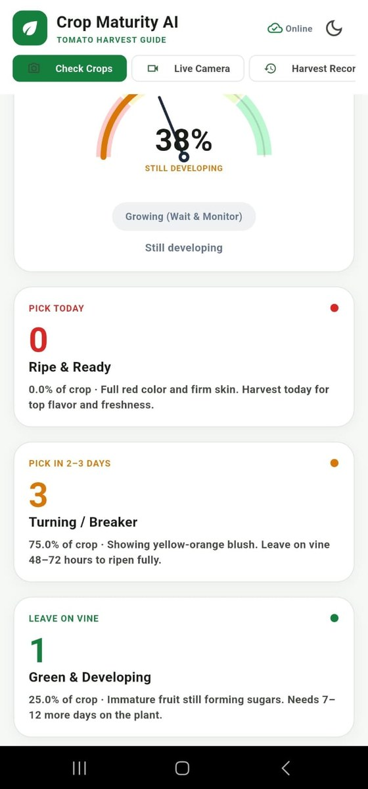
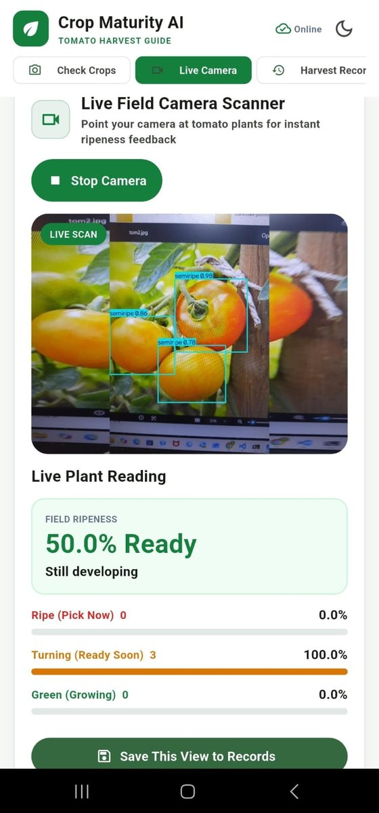
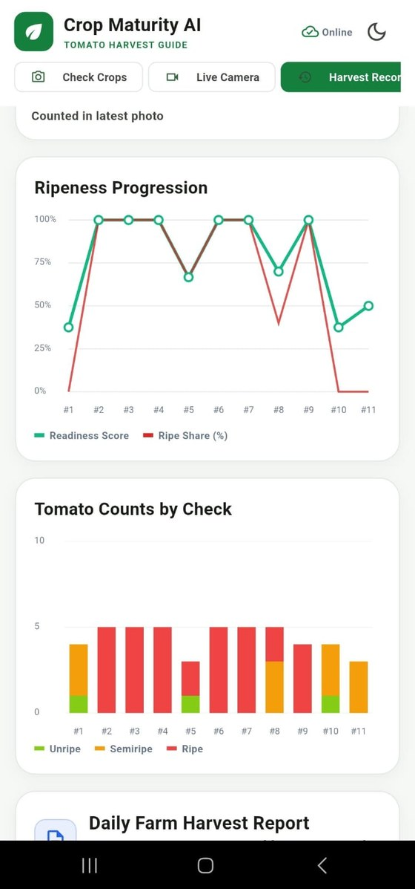
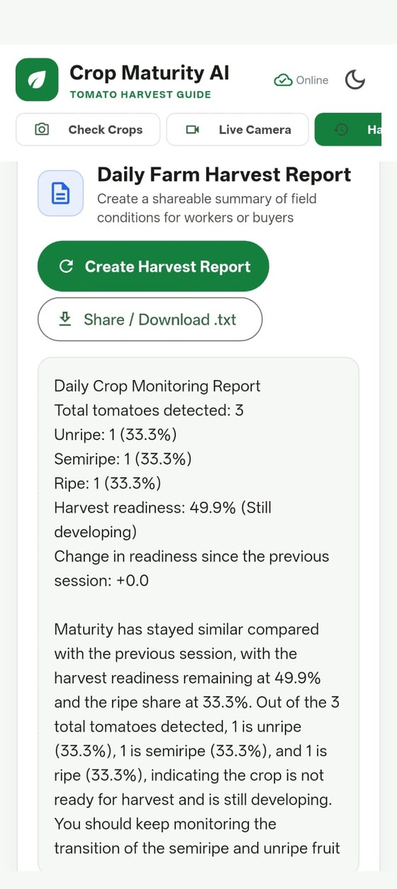
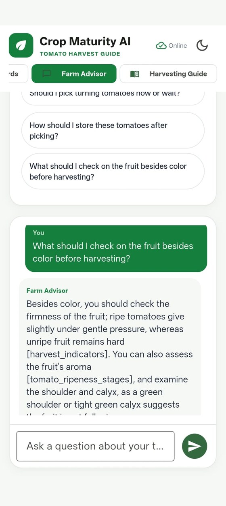
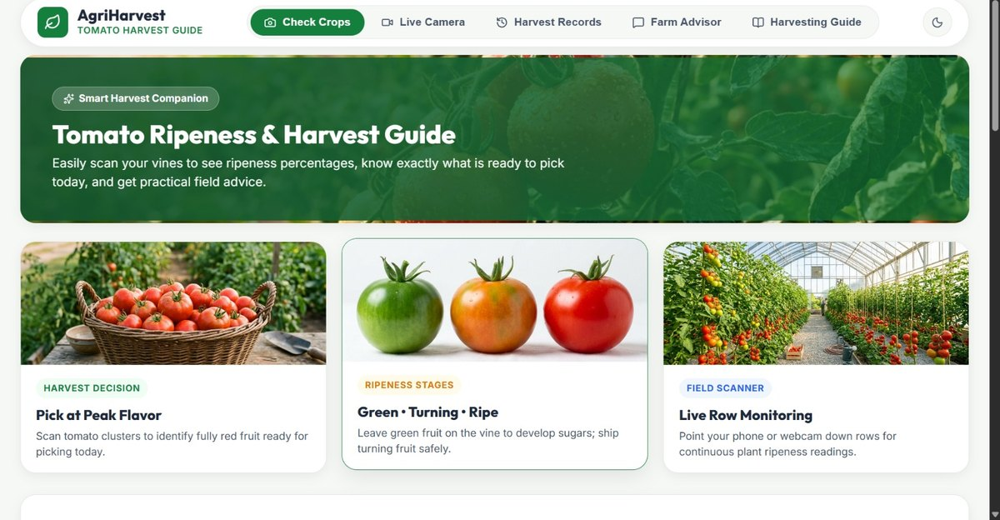
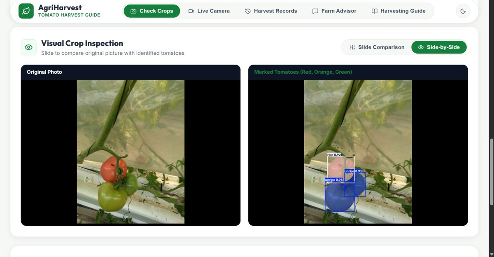
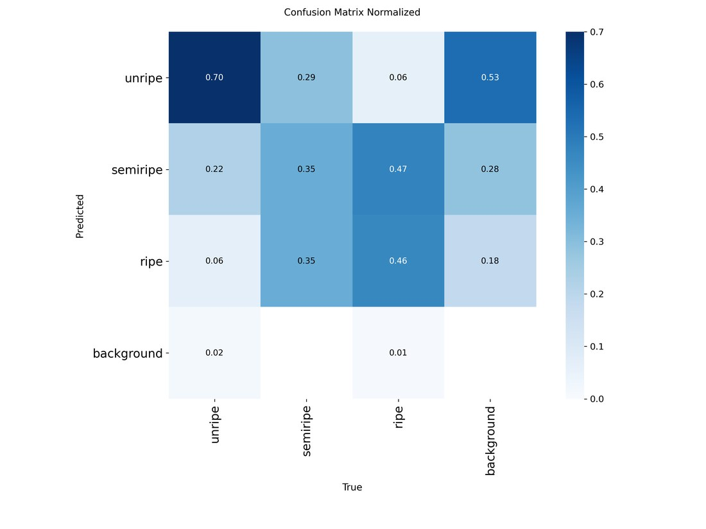
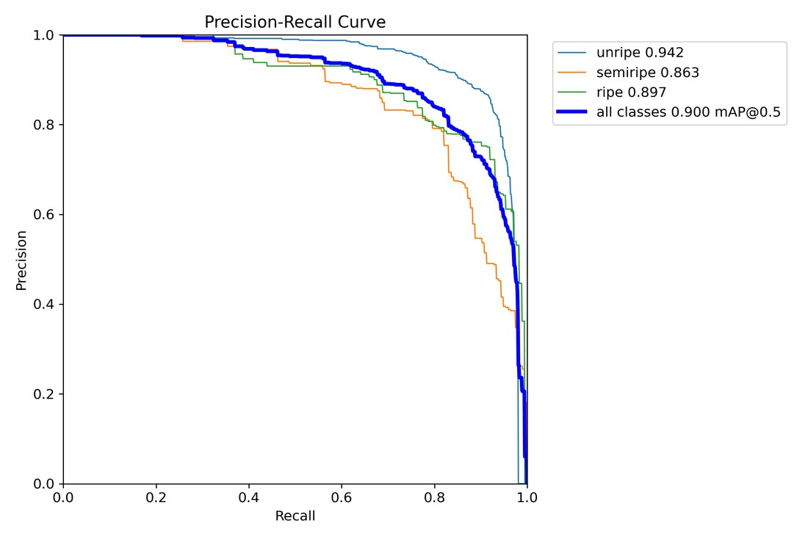

# Crop Maturity AI – Tomato Harvest Readiness

**AI-powered tomato maturity detection and harvest-readiness analysis, delivered as a website and a Flutter mobile app.**


Farmers judge tomato ripeness by eye, which is slow and subjective. Take a photo (or scan with the live camera) and the system **detects every tomato, classifies it as unripe, semiripe or ripe, counts them, scores harvest readiness, and explains what to do next in plain language**.

> Built during an internship at **Rasa.AI Labs, Chennai** by Anisha J, Thahrinah H and Jasmin Nirmala D (SSM Institute of Engineering and Technology, Dindigul).

## Key Results

| Metric | Value |
|---|---|
| Mask mAP@50 (validation, best epoch) | **0.900** |
| Mask precision / recall | 0.809 / 0.863 |
| Mask mAP@50–95 | 0.794 |
| Per-class AP@50 (unripe / semiripe / ripe) | 0.942 / 0.863 / 0.897 |
| Counting F1 on 60 unseen test images (543 tomatoes) | **0.89** (precision 0.91, recall 0.87) |
| Average count error | 1.25 tomatoes per image |
| Count accuracy on clear / partly hidden fruit | 96% / 91% of true count |
| Inference on CPU (640 px, with CLIP check) | ~1.0 s per image (~2.2 FPS without the check) |

Blurry and low-light photos are detected and flagged to the user, because accuracy drops sharply in those conditions (see [Limitations](#limitations)).

## Features

- **Instance segmentation** with YOLOv8m-seg into 3 maturity stages: unripe, semiripe, ripe
- **CLIP verification** to remove non-tomato look-alikes (leaves, stems, red objects)
- **Harvest-readiness score** with status bands and pick-timing advice (Pick Today / Pick in 2–3 Days / Leave on Vine)
- **Image-quality checks** for blur and low light before analysis
- **Live camera scanning** in the website and the mobile app
- **AI advisor (RAG)**: Gemini answers questions from an agricultural knowledge base (ChromaDB), shows its sources, and only quotes the measured numbers, so it never invents counts
- **History and trends**: saved inspections, ripeness-progression charts and a downloadable daily farm report
- **Two clients, one backend**: React website and Flutter app (Android and iOS)

## Screenshots

| Mobile app | | | |
|:--:|:--:|:--:|:--:|
|  |  |  |  |
| Home | Harvest verdict | Live scan | Ripeness trend |
|  |  | | |
| Daily report | AI advisor with sources | | |

| Website | |
|:--:|:--:|
|  |  |
| Home | Original vs. marked tomatoes |

## How It Works

```text
Photo / camera frame
  → quality check (blur, brightness)
  → YOLOv8m-seg: segment + classify each tomato
  → CLIP: reject non-tomato detections
  → counts, maturity %, harvest readiness
  → RAG + Gemini: explanation, report, advice (numbers checked against measured values)
```

**Harvest readiness** = `ripe % + 0.5 × semiripe %`

| Readiness | Status |
|---|---|
| ≥ 85% | Ready to harvest |
| 60–84% | Approaching harvest stage |
| 30–59% | Still developing |
| < 30% | Not ready |

Example: 4 tomatoes detected (0 ripe, 3 semiripe, 1 unripe) → 0 + 0.5 × 75 = 37.5% → *Still developing*.

## Model and Data

- **Dataset:** [LaboroTomato](https://github.com/laboroai/LaboroTomato), converted to YOLO segmentation format with 3 classes
- **Split:** 547 training images (6,612 tomatoes: 4,363 unripe, 1,116 semiripe, 1,133 ripe), 60 validation, 60 test
- **Training:** pretrained yolov8m-seg, 1280 px, batch 8, early stopping (best epoch 58 of 78)

| Normalised confusion matrix | Precision–recall curves |
|:--:|:--:|
|  |  |

## Tech Stack

| Layer | Technology |
|---|---|
| Vision | Python 3.11, PyTorch, Ultralytics YOLOv8, OpenCV, CLIP (Hugging Face) |
| GenAI | Gemini (with configurable backup provider), RAG, ChromaDB embeddings |
| Backend | FastAPI, Pydantic, Uvicorn, SQLite history |
| Clients | React (website), Flutter / Dart (Android and iOS) |

## API

| Method | Endpoint | Purpose |
|---|---|---|
| `GET` | `/health` | Backend and model status |
| `POST` | `/predict` | Analyse an uploaded image |
| `GET` | `/history` | Saved analyses |
| `GET` | `/crop-statistics` | Crop counts |
| `GET` | `/harvest-readiness` | Latest readiness score |
| `POST` | `/ai/analyze` | AI analysis and recommendations |
| `POST` | `/ai/report` | Daily report |
| `POST` | `/ai/chat` | Ask a question (with knowledge-base sources) |

Interactive docs: `http://127.0.0.1:8000/docs`

## Quick Start

```bash
git clone https://github.com/Jasmin-IT/CROPMATURITY-AI.git
cd CROPMATURITY-AI
python -m venv .venv && source .venv/bin/activate   # Windows: .\.venv\Scripts\Activate.ps1
pip install -r requirements.txt
# optional: add GEMINI_API_KEY=your_key to a .env file (rule-based answers work without it)
python -m uvicorn app.api:app --reload --host 127.0.0.1 --port 8000
```

Model weights are expected at `models/yolov8m_seg_best.pt`.

**Website:** `npm install --prefix frontend` then `npm run dev`

**Mobile app:**
```bash
cd mobile && flutter pub get
flutter run --dart-define=API_BASE=http://10.0.2.2:8000   # Android emulator; use your PC's LAN IP for a real phone
```

## Project Structure

```text
app/              FastAPI backend, detection, database, AI and RAG
frontend/         React website
mobile/           Flutter app (Android / iOS)
knowledge_base/   Agricultural documents for RAG
models/           YOLO weights
scripts/          Dataset preparation, evaluation, benchmarks
```

## Limitations

- Semiripe is the hardest class: ripe and semiripe fruit are often confused, and the training data is about two-thirds unripe.
- Blurry or dark photos reduce counts sharply (31% and 48% of the true count in testing); the app warns the user to retake the photo.
- Very crowded scenes are undercounted (70% of the true count).
- Readiness is an AI-assisted indicator of the maturity mix, not a guaranteed harvest date. The status bands are project-defined and should be validated by agronomists.

## Credits

[LaboroTomato](https://github.com/laboroai/LaboroTomato) · [Ultralytics YOLO](https://github.com/ultralytics/ultralytics) · [OpenAI CLIP](https://github.com/openai/CLIP) · ChromaDB · FastAPI · Flutter · React. Please review dataset and dependency licenses before redistributing.
